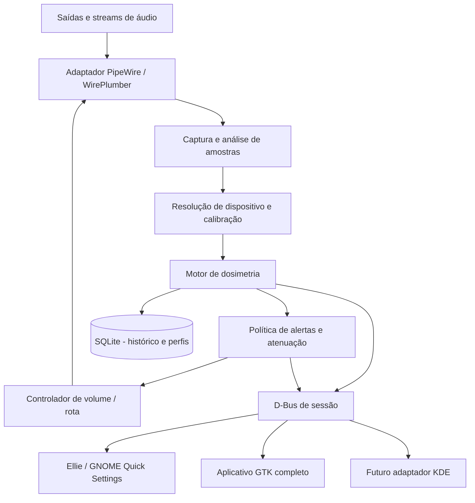
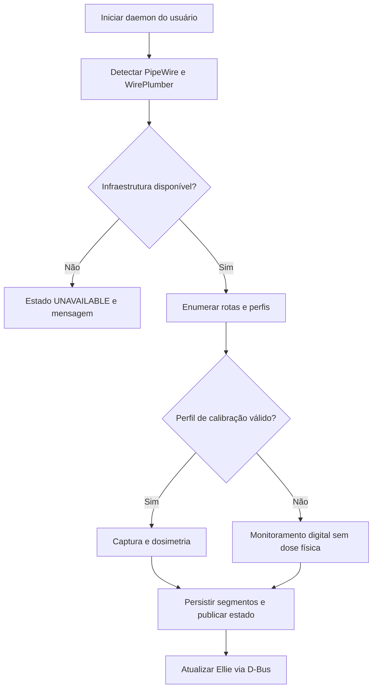
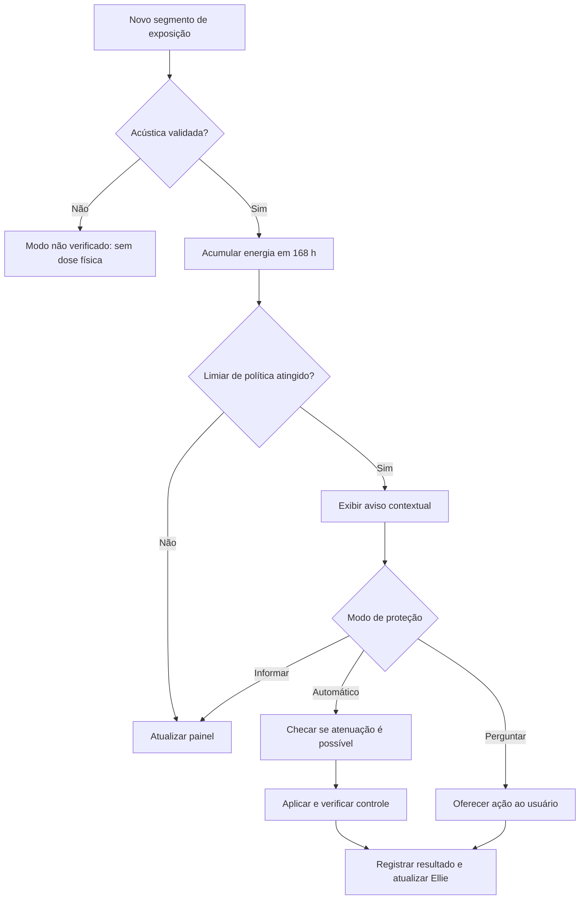

# SafeListen Linux

> **Proteja sua audição sem perder o ritmo.**  
> Documentação de produto, pesquisa, UX/UI, arquitetura, modelo matemático e especificação de implementação.  
> **Mascote:** Ellie, uma pequena elefanta inspirada no formato de uma orelha.  
> **Status:** proposta de produto e plano técnico; **não é um aplicativo implementado nem um dispositivo médico validado**.  
> **Versão do documento:** 1.0 — 29 de outubro de 2026.  
> **Idioma da interface inicial:** português do Brasil, com suporte planejado a internacionalização.

---

## Sumário

1. [Visão geral](#1-visão-geral)
2. [Problema, motivação e objetivos](#2-problema-motivação-e-objetivos)
3. [Fundamentação científica e limites](#3-fundamentação-científica-e-limites)
4. [Panorama de soluções existentes](#4-panorama-de-soluções-existentes)
5. [Identidade visual e mascote Ellie](#5-identidade-visual-e-mascote-ellie)
6. [Experiência do usuário](#6-experiência-do-usuário)
7. [Escopo e requisitos](#7-escopo-e-requisitos)
8. [Modelo matemático de exposição sonora](#8-modelo-matemático-de-exposição-sonora)
9. [Medição, calibração e níveis de confiança](#9-medição-calibração-e-níveis-de-confiança)
10. [Arquitetura técnica](#10-arquitetura-técnica)
11. [Modelo de dados e interfaces](#11-modelo-de-dados-e-interfaces)
12. [Políticas de alertas e proteção automática](#12-políticas-de-alertas-e-proteção-automática)
13. [Fluxos funcionais](#13-fluxos-funcionais)
14. [Segurança, privacidade, acessibilidade e desempenho](#14-segurança-privacidade-acessibilidade-e-desempenho)
15. [Plano de desenvolvimento](#15-plano-de-desenvolvimento)
16. [Validação e critérios de aceitação](#16-validação-e-critérios-de-aceitação)
17. [Riscos, limites e decisões pendentes](#17-riscos-limites-e-decisões-pendentes)
18. [Instruções de implementação para outra IA](#18-instruções-de-implementação-para-outra-ia)
19. [Fontes e referências](#19-fontes-e-referências)

---

## 1. Visão geral

**SafeListen Linux** é uma proposta de software livre de prevenção e conscientização sobre exposição sonora em computadores Linux. Seu objetivo é ajudar pessoas que passam muitas horas com música, jogos, vídeos, reuniões e outros conteúdos de áudio a compreender e reduzir a exposição potencialmente prejudicial.

O sistema deverá **observar a atividade de reprodução de áudio, estimar a exposição acústica quando houver dados de calibração suficientes, acumular a dose sonora ao longo de sete dias, apresentar informações claras e oferecer controle automático de volume**.

A experiência visual será ancorada em **Ellie**, uma elefantinha minimalista, de orelhas grandes e expressivas. O desenho é deliberadamente híbrido: a silhueta deve sugerir primeiro uma orelha e, ao olhar melhor, a cabeça simpática de um elefante. O mascote aparece em um indicador pequeno do sistema e em um painel com progresso e recomendações.

### 1.1 Proposta de valor

- Tornar inteligível o impacto combinado de **intensidade, duração e repetição** da exposição a sons altos.
- Transformar um indicador técnico em experiência **discreta, agradável e acionável**.
- Adaptar o comportamento ao dispositivo: **fones, caixas de som ou saídas desconhecidas**.
- Oferecer **redução preventiva de volume** sem alegar que controles percentuais isolados são equivalentes a níveis de dBA.
- Funcionar **localmente**, com atenção a privacidade, transparência e compatibilidade com diferentes desktops Linux.

### 1.2 Público-alvo

Pessoas que trabalham por várias horas no computador; desenvolvedores; estudantes; jogadores; criadores de conteúdo; usuários de headset em chamadas; pessoas que desejam acompanhar hábitos de escuta. A versão inicial será direcionada a usuários adultos; um modo conservador para crianças ou pessoas sensíveis pode ser previsto para etapa posterior, com revisão de UX e proteção adequada.

### 1.3 Princípios de produto

1. **Segurança sem falsa precisão:** sem calibração suficiente, nunca exibir dBA/dose como se fossem medidos.
2. **Prevenção, não diagnóstico:** o app não identifica perda auditiva e não substitui avaliação profissional.
3. **Transparência:** mostrar o que foi monitorado, por quanto tempo e com qual confiabilidade.
4. **Intervenções compreensíveis:** reduzir volume de modo previsível; evitar alterações inesperadas ou restauros abruptos.
5. **Baixa fricção:** a Ellie comunica sem exigir que o usuário abra gráficos a todo momento.
6. **Software livre e extensível:** separar motor de processamento, política de proteção e apresentação.

---

## 2. Problema, motivação e objetivos

### 2.1 Problema

Pessoas podem usar computadores por horas com fones ou caixas de som e raramente possuem uma visão útil da energia sonora à qual foram expostas. Um indicador de volume em porcentagem é insuficiente: não informa o nível real de pressão sonora no ouvido. A exposição intensa ou repetida pode provocar perda auditiva induzida por ruído, potencialmente permanente.

**Risco = função do nível acústico real + duração + recorrência + suscetibilidade individual.** A ferramenta não observa todas essas variáveis, nem a exposição ocorrida fora do computador; por isso deve representar explicitamente seu escopo.

### 2.2 Objetivo geral

Projetar e implementar uma ferramenta Linux de acompanhamento e mitigação da exposição sonora associada à reprodução de áudio do computador, com modelo de dosimetria fundamentado nas recomendações OMS/UIT e interface amigável baseada no mascote Ellie.

### 2.3 Objetivos específicos

- Detectar dispositivos e rotas ativas de áudio do sistema.
- Distinguir reprodução efetiva de um dispositivo conectado, porém silencioso.
- Medir grandezas digitais e, onde aplicável, **estimar ou medir a pressão sonora ponderada A**, com método e incerteza explicitados.
- Calcular e persistir exposição acumulada em janela móvel de **sete dias**.
- Exibir indicadores de dose e alertas com contexto e precisão apropriados.
- Disponibilizar controle de volume automático, assistido ou apenas informativo.
- Permitir o gerenciamento de perfis de equipamentos e recalibração.
- Produzir métricas agregadas sem armazenar gravações de áudio.

### 2.4 Fora do escopo inicial

- Diagnóstico médico, audiometria, tratamento ou certificação de prevenção de perda auditiva.
- Medição confiável do ruído ambiente sem microfone e procedimento de calibração adequados.
- Estimativa de exposição a outras fontes, como trânsito, shows, academia ou telefone fora do computador.
- Garantia de funcionamento com toda a diversidade de DACs, amplificadores, Bluetooth, hardware e ambientes gráficos.
- Integração imediata com sistemas móveis ou firmware de headsets.

---

## 3. Fundamentação científica e limites

### 3.1 Relação entre nível e tempo

O nível acústico **dBA SPL** é uma representação logarítmica da pressão sonora com ponderação de frequência A. A energia sonora cresce exponencialmente com o aumento do nível em decibéis. O princípio de **energia equivalente** permite comparar exposições de níveis e durações diferentes.

A OMS/UIT utiliza como referências recreativas para sistemas pessoais:

| Perfil de referência | Equivalência semanal | Referência energética |
|---|---:|---:|
| Adultos (Modo 1) | **80 dBA durante 40 horas por 7 dias** | **1,6 Pa²·h** |
| Crianças / modo mais conservador (Modo 2) | **75 dBA durante 40 horas por 7 dias** | **0,51 Pa²·h** |

*Nota:* são referências para gerenciamento de exposição e redução de risco, **não limites universais que asseguram ausência de lesão**. A suscetibilidade individual varia. Os valores devem ser tratados como orientações técnicas da OMS/UIT, não como diagnóstico.

### 3.2 Tempos equivalentes para adultos

Usando a regra de energia equivalente, os valores aproximados para um **nível constante e validamente conhecido** são:

| Nível | Tempo até 100% da referência semanal de adultos |
|---|---:|
| 70 dBA | 400 horas (valor teórico; excede as 168 h de uma semana) |
| 75 dBA | 126,5 horas |
| 80 dBA | 40 horas |
| 85 dBA | 12 h 39 min |
| 90 dBA | 4 horas |
| 95 dBA | 1 h 16 min |
| 100 dBA | 24 min |
| 105 dBA | 7,6 min |

Esses números são calculados a partir da equação energética e diferem ligeiramente de tabelas divulgativas arredondadas. O app não deve afirmar que, por exemplo, **50 dBA durante quatro horas** é prejudicial; tal limite não é sustentado pela referência utilizada.

### 3.3 Referência ocupacional diferente

O **NIOSH** adota limite recomendado para trabalhadores de **85 dBA em média por oito horas diárias**, com regra de aproximadamente metade do tempo para cada aumento de 3 dB. É uma referência de exposição **ocupacional**, com hipóteses próprias, e **não deve ser combinada diretamente** com a dose recreativa semanal da OMS/UIT. A versão inicial adota a referência OMS/UIT; perfis adicionais exigem separação explícita por finalidade.

### 3.4 Tipos de decibel e métricas

| Grandeza | Descrição | Papel no SafeListen |
|---|---|---|
| **dBFS** | Amplitude digital relativa ao máximo representável | Monitoramento de sinal; **não** é intensidade acústica no ouvido |
| **LUFS/LKFS** | Métrica de loudness do conteúdo digital | Diagnóstico complementar de conteúdo, sem conversão direta para dBA |
| **dBA SPL** | Nível de pressão sonora física ponderado A | Entrada desejada da dosimetria quando há medição ou calibração válida |
| **Pa²·h** | Integral energética de pressão sonora ponderada A | Unidade de acumulação de dose conforme referências OMS/UIT |

**Regra crítica:** 60% de volume **não significa** 60 dBA e não permite derivar uma exposição acústica real sem calibração da cadeia. LUFS também não se converte em dBA por uma constante universal.

### 3.5 Normas fundamentais

- **ITU-T H.870 (03/2022):** diretrizes para dispositivos e sistemas de escuta segura, incluindo dosimetria, estimativa, incerteza, comunicação e controle de volume. É a **referência principal**.
- **ITU-T H.872 (10/2024):** escuta segura em videogames e esports, com aplicação a computadores e periféricos. É a **referência complementar para UX, transição de equipamentos e proteção no contexto de jogos**.
- **OMS/UIT, Global standard for safe listening video gameplay and esports (2025):** documento explicativo aplicado à indústria e experiência de jogadores.
- **NIOSH:** referência adicional para compreensão da regra de troca de 3 dB, sem confundir com os critérios recreativos.

Não se deve declarar conformidade ou certificação com essas normas até concluir os testes formais aplicáveis.

---

## 4. Panorama de soluções existentes

O projeto não parte do pressuposto de que limitadores de volume ou dosímetros sejam inéditos. O espaço de diferenciação está na **integração consistente entre dosimetria calibrada, visualização acessível, política de proteção e experiência amigável**.

| Referência | Capacidades relacionadas | Lacuna que o SafeListen procura abordar |
|---|---|---|
| **EasyEffects** | Processamento de áudio PipeWire, medidores, limitador, compressor e vários efeitos | Não foi concebido primariamente como acompanhamento personalizado da dose auditiva em sete dias |
| **Headphone Volume Limiter** (GNOME, código no GitHub) | Limite percentual e avisos quando fones estão ativos | Não oferece por si só determinação calibrada da dose acústica |
| **WirePlumber / `wpctl`** | Consulta e alteração de dispositivos, rotas e volume | Infraestrutura de áudio, não produto final de saúde auditiva |
| **Sound Open Firmware — Sound Dose** | Arquitetura DSP de energia/atenuação e dados de exposição | Integração depende do hardware, firmware e rota de áudio disponíveis |
| **Padrão ITU-T H.870/H.872** | Critérios e recomendações de implementação | É uma especificação, não aplicativo Linux de uso geral |

**Conclusão de pesquisa:** há componentes e projetos que cobrem partes importantes do problema. Não foi verificada, nesta pesquisa, uma solução Linux universal e consolidada com **todas** as funcionalidades propostas; isso não prova inexistência de projetos semelhantes. Antes da publicação, repetir uma revisão de estado da arte e de licenças.

---

## 5. Identidade visual e mascote Ellie

### 5.1 Marca

- **Nome provisório do produto:** SafeListen Linux.
- **Mascote:** **Ellie**.
- **Conceito:** elefantinha estilizada cuja forma lembra uma orelha humana.
- **Frase principal:** *Proteja sua audição sem perder o ritmo.*
- **Tom:** amistoso, adulto, acolhedor, objetivo e não alarmista.
- **Identidade visual:** minimalista, arredondada, leve e reconhecível em tamanhos pequenos.

O nome e a marca são **provisórios**, sujeitos à verificação posterior de disponibilidade jurídica, nomes de domínio e conflitos de marca. Evitar referências visuais a personagens licenciados de terceiros.

### 5.2 Descrição visual do ícone

- Forma base: uma orelha arredondada que, com poucos traços, sugere cabeça, orelha e tromba de um elefante.
- Preferência por **formas vetoriais simples**, sem contornos finos demais.
- Expressões: olhos pequenos e movimentos sutis, sem depender de elementos que desaparecem em 16–24 px.
- Nos tamanhos de painel pequenos, usar **silhueta monocromática e sem rosto detalhado**, se necessário.
- No painel expandido, permitir corpo expressivo, olhos, trombinha e orelha em movimento.
- Suporte a temas claro, escuro e alto contraste.
- Toda mensagem transmitida por cor ou animação deve existir também em texto ou ícone acessível.

### 5.3 Cores sugeridas (não normativas)

| Uso | Tom sugerido | Cor de referência |
|---|---|---|
| Neutro / tranquilo | Verde menta | `#52BDA3` |
| Informativo | Azul suave | `#79A8DE` |
| Atenção | Âmbar | `#E0AD4E` |
| Exposição alta | Coral | `#DD835F` |
| Referência excedida | Vermelho suave | `#D56E70` |

Os contrastes reais devem ser testados nas interfaces, não apenas aceitos por essas sugestões. **Cor verde não deve comunicar “audição segura”** quando não houver medição confiável.

### 5.4 Estados do mascote

| Estado lógico | Aparência / animação sugerida | Observação |
|---|---|---|
| `UNVERIFIED` | Ellie neutra, discreta, com pequeno ponto de interrogação | O equipamento não possui dados suficientes para dosimetria |
| `IDLE` | Respiração quase imperceptível | Sem reprodução detectada |
| `NORMAL` | Ellie relaxada, orelha mexe ocasionalmente | Dose abaixo dos limiares configurados, **desde que a fonte seja confiável** |
| `NOTICE` | Ellie mais atenta | Limiar informativo atingido |
| `WARNING` | Orelha e olhos expressam atenção | Exposição elevada estimada / medida |
| `EXCEEDED` | Ellie preocupada, aviso textual claro | Referência semanal excedida |
| `PROTECTING` | Ellie confirma atenuação, sem celebrar excesso de exposição | Sistema reduziu a saída e validou a alteração possível |
| `ERROR` | Ícone técnico de indisponibilidade | Falha de captura, rota, calibração ou controle |

**Nunca usar expressões “100% protegido”, “audição saudável” ou “sem risco”.** A mascote expressa estado de monitoramento e recomendações, não condição clínica.

### 5.5 Microinterações

- **Hover:** inclinação discreta da orelha/tromba, destaque do anel e resumo do estado, quando o ambiente gráfico suportar hover.
- **Clique:** abre popover ou painel de visão geral.
- **Mudança de dose:** transição suave da fração do anel, sem animação contínua desnecessária.
- **Alerta:** uma reação curta de Ellie seguida de mensagem com ação objetiva.
- **Redução automática:** breve mudança da expressão e indicação textual do novo volume.
- **Movimento reduzido:** desativar loops e substituir movimentos por transições discretas ou estados estáticos.

**Atenção ao GNOME:** não pressupor uma bandeja universal animada. A integração GNOME deve priorizar a API atual de **Quick Settings** e um indicador compatível com a versão suportada do GNOME Shell. Algumas animações podem existir apenas no popover, não no ícone pequeno. No KDE e em outras áreas de trabalho, usar uma integração apropriada, sem forçar implementação única.

### 5.6 Entregáveis de design

1. SVG mestre da Ellie, licenciado de forma compatível com o projeto.
2. Variantes monocromáticas em 16, 24 e 32 px.
3. Versão detalhada para 96/128/256 px.
4. Estados estáticos e, opcionalmente, animações vetoriais para popover.
5. Biblioteca de tokens de design (cor, espaçamento, tipografia, redução de movimento).
6. Guia de acessibilidade e descrições textuais dos estados.

---

## 6. Experiência do usuário

### 6.1 Filosofia da interface

Mostrar o essencial em **três camadas de informação**:

1. **Indicador compacto:** Ellie + estado curto; sem sobrecarregar a barra do sistema.
2. **Popover rápido:** dose semanal, fonte ativa, confiança da medida, controle automático e ação principal.
3. **Janela completa:** histórico, gráficos, calibração, perfis, regras, explicações e preferências.

### 6.2 Painel rápido: proposta

```text
┌─────────────────────────────────────────┐
│  [Ellie]  SafeListen           [Ajustes] │
│                                         │
│       ( Ellie + anel de progresso )      │
│                                         │
│           43% da referência            │
│          Exposição acompanhada          │
│                                         │
│  Últimos 7 dias · Fonte calibrada        │
│  Dispositivo: Headset USB                │
│                                         │
│  Proteção automática           [Ligada]  │
│                                         │
│  [Ver histórico]  [Perfis de áudio]      │
└─────────────────────────────────────────┘
```

A porcentagem ilustrativa só aparece quando o sistema conhece uma dose fundamentada. Em modo não calibrado, substituí-la por **“Dose indisponível: calibre seu dispositivo”**, com informações digitais explicitamente rotuladas.

### 6.3 Onboarding

1. Explicar que o SafeListen **não consegue converter porcentagem do volume em dBA automaticamente**.
2. Detectar os dispositivos de áudio e sua categoria aparente.
3. Perguntar como o equipamento é utilizado: fone intra-auricular, circumaural, caixa de som etc. (informação de categoria não equivale à calibração).
4. Oferecer modo básico de prevenção de volume e indicar suas limitações.
5. Oferecer configuração de perfil acústico validado quando o usuário possuir dados adequados.
6. Pedir consentimento para eventuais recursos de microfone; **não capturar microfone por padrão**.
7. Escolher comportamento: apenas informar, perguntar antes de reduzir, ou redução automática (quando tecnicamente suportada).
8. Mostrar Ellie em exemplo de estado **simulado**, identificado como demonstração.

### 6.4 Textos de interface propostos

- **Sem calibração:** “A Ellie está acompanhando o áudio, mas ainda não consegue calcular a exposição real deste dispositivo.”
- **Aviso intermediário:** “Sua exposição acumulada está aumentando. Que tal diminuir um pouco o volume?”
- **Referência excedida:** “Você ultrapassou a referência semanal para este perfil. Continuar ouvindo no mesmo nível aumenta o risco.”
- **Redução aplicada:** “A Ellie reduziu o volume deste dispositivo. Confira se ele ficou confortável.”
- **Falha de proteção:** “Não consegui controlar esta saída de áudio. Ajuste o volume diretamente no equipamento.”
- **Dispositivo trocado:** “Você mudou de saída. Vou verificar se o novo dispositivo tem um perfil válido.”

As mensagens devem evitar culpabilização, gamificação de “quase chegar a 100%” e afirmações clínicas.

### 6.5 Barra/anel de progresso

- Preferir **anel** em volta da Ellie, com texto numérico visível no painel.
- Limite visual de preenchimento: 100%, mas **exibir explicitamente 125%, 150% etc.** no texto quando houver excedente; não truncar o valor de dose.
- Diferenciar dose **medida/calibrada**, **estimativa com incerteza** e **indisponível**.
- A dose é um **indicador de referência consumida, não barra de “saúde” ou dano acumulado no corpo**.
- Informar cobertura: “som monitorado neste computador” e, quando pertinente, “não inclui exposição fora do dispositivo”.

---

## 7. Escopo e requisitos

### 7.1 Requisitos funcionais

| ID | Requisito | Prioridade |
|---|---|---|
| RF-001 | Detectar saídas, mudança de dispositivo, conexão/desconexão e volume atual pelo PipeWire/WirePlumber | P0 |
| RF-002 | Distinguir fluxo com áudio efetivo de silêncio e mute | P0 |
| RF-003 | Coletar métricas digitais sem armazenar conteúdo de áudio | P0 |
| RF-004 | Registrar sessões e métricas por dispositivo e rota de saída | P0 |
| RF-005 | Manter motor de dosimetria isolado, testável e independente da interface | P0 |
| RF-006 | Calcular dose sobre **janela móvel de 7 × 24 h**, com entradas válidas | P0 |
| RF-007 | Identificar explicitamente nível de confiança da medição | P0 |
| RF-008 | Nunca apresentar dose ou dBA como reais em perfil não calibrado | P0 |
| RF-009 | Exibir Ellie e estado textual correspondente | P0 |
| RF-010 | Mostrar painel rápido com fonte, exposição e confiança | P1 |
| RF-011 | Registrar perfis de dispositivos e dados de calibração | P1 |
| RF-012 | Emitir alertas configuráveis e não excessivos | P1 |
| RF-013 | Reduzir volume de uma saída suportada, com política de proteção e feedback | P1 |
| RF-014 | Persistir histórico local e recuperar estado após reinício | P1 |
| RF-015 | Disponibilizar histórico de dose, sessões e mudanças de dispositivo | P1 |
| RF-016 | Permitir exportar e excluir histórico pessoal | P1 |
| RF-017 | Suportar preferências de animação, tema, idioma e notificações | P1 |
| RF-018 | Integrar ao GNOME Quick Settings sem concentrar lógica de negócio na extensão | P1 |
| RF-019 | Detectar invalidação de calibração ao mudar equipamentos/configurações | P1 |
| RF-020 | Oferecer modo básico de proteção percentual **sem afirmar proteção clínica** | P1 |
| RF-021 | Suportar KDE ou outra interface gráfica por adaptador independente | P2 |
| RF-022 | Suportar módulo separado para caixas de som com medição ambiental calibrada | P2 |
| RF-023 | Oferecer modo mais conservador conforme referência OMS/UIT, com revisão das regras e UX | P2 |
| RF-024 | Permitir importação de perfis validados e teste de consistência da calibração | P2 |

**P0:** viabiliza a prova de conceito segura. **P1:** produto funcional inicial. **P2:** evolução.

### 7.2 Requisitos não funcionais

| ID | Requisito / critério pretendido |
|---|---|
| RNF-001 | Operar localmente, sem servidor obrigatório nem telemetria de conteúdo |
| RNF-002 | Não persistir PCM, voz, músicas ou transcrições |
| RNF-003 | Não executar IO de disco, SQL, alocação pesada ou UI no callback em tempo real de áudio |
| RNF-004 | Reagir a eventos de alteração de saída de áudio sem precisar de polling agressivo |
| RNF-005 | Suportar desconexão, falha e reinicialização sem corromper dados de exposição |
| RNF-006 | Fornecer dados numéricos e texto acessíveis, inclusive sem animação |
| RNF-007 | Privilegiar operação não privilegiada em sessão do usuário |
| RNF-008 | Manter testes unitários determinísticos para a matemática e os estados de proteção |
| RNF-009 | Documentar versão mínima de PipeWire, WirePlumber, GNOME/KDE e distros após os testes |
| RNF-010 | Exibir incerteza, fonte e escopo de captura sempre que existirem estimativas |
| RNF-011 | Evitar mudanças bruscas de ganho; reversão deve ser explícita e previsível |
| RNF-012 | Alvo inicial de baixo consumo: avaliar CPU, RAM, wakeups e latência em hardware real antes de definir orçamento final |

### 7.3 Casos de uso prioritários

- **UC-01:** utilizar música em headset calibrado; dose aumenta à medida que o áudio é reproduzido.
- **UC-02:** pausar a música; o contador não acumula duração de áudio inexistente.
- **UC-03:** trocar headset por caixas de som; o perfil é reavaliado e não se herda a calibração anterior.
- **UC-04:** exposição atingir limiar de alerta; Ellie muda seu estado e oferece ação.
- **UC-05:** proteção ativada; sistema aplica atenuação verificável quando a rota permitir.
- **UC-06:** reiniciar o Linux; histórico anterior permanece e a janela móvel não reinicia.
- **UC-07:** usar dispositivo desconhecido; app informa monitoramento digital sem alegar dose real.
- **UC-08:** interromper monitoramento; app sinaliza intervalo não monitorado e não o contabiliza como exposição zero.

---

## 8. Modelo matemático de exposição sonora

### 8.1 Unidade física e referência

Se for conhecida a pressão acústica ponderada A `p_A(t)` em pascals, a exposição energética é:

\[
E_A = \int_{t_1}^{t_2} p_A(t)^2\,dt
\]

Quando `t` é expresso em horas, o resultado está em **Pa²·h**. Para nível acústico em dBA:

\[
L_A = 10\log_{10}\left(\frac{p_A^2}{p_0^2}\right),\qquad p_0 = 20\,\mu\text{Pa}
\]

Para um nível equivalente constante `L_Aeq` durante `Δt` horas:

\[
E_i = (20\times10^{-6})^2\,10^{L_{Aeq,i}/10}\,\Delta t_i
\]

A referência de adultos é:

\[
E_{ref,adulto}=1{,}6\;\text{Pa}^2\!\cdot\!h
\]

E o modo conservador segundo a referência OMS/UIT:

\[
E_{ref,modo2}\approx0{,}51\;\text{Pa}^2\!\cdot\!h
\]

Esses valores resultam do nível de referência durante 40 horas, com arredondamento de apresentação.

### 8.2 Dose percentual em sete dias

\[
D_{7d}(t)=100\;\frac{\sum_{i:\,[t_i,t_i+\Delta t_i]\cap[t-7d,t]\neq\varnothing} E_{i,\,interseção}}{E_{ref}}
\]

Ou, diretamente para adultos, com nível médio conhecido por segmento:

\[
D_{7d}(t)=\frac{100}{40}\sum_i\frac{\Delta t_i}{1\,h}\,10^{(L_{Aeq,i}-80)/10}
\]

Somar apenas a fração temporal **incluída na janela móvel**. Para segmentos que cruzam o limite da janela, é necessário integrar ou dividir em segmentos menores, nunca incluir o bloco inteiro indiscriminadamente.

### 8.3 Tempo equivalente a um nível constante

\[
T(L)=40\cdot10^{(80-L)/10}\ \text{horas}
\]

A regra informal de “cada 3 dB, metade do tempo” é uma aproximação; a diferença exata para dobrar a energia é aproximadamente **3,0103 dB**.

### 8.4 Exemplos de cálculo

- **80 dBA por 40 h** em sete dias: 100% da referência adulta.
- **90 dBA por 2 h**: aproximadamente 50% da referência.
- **80 dBA por 10 h + 90 dBA por 2 h**: aproximadamente **75%** da referência.
- **Som desligado ou amostras efetivamente silenciosas**: dose de áudio reproduzido próxima de zero, respeitando limites de medição e detecção.
- **Sem nível acústico confiável**: resultado **não calculável como dose física pessoal**; jamais preencher com equivalência inventada entre percentuais e dBA.

### 8.5 Granularidade e energia por canal

- Iniciar com janelas de análise de aproximadamente **1 segundo**, preservando amostras ou subsegmentos menores quando necessário para tratamento do limite móvel.
- Para estéreo, observar a norma vigente quanto à combinação energética dos canais, correção de resposta e referência acústica; **não usar média aritmética de dB**.
- A fórmula de média energética de canais em dB é `10 × log10((10^(L/10) + 10^(R/10))/2)`, caso este seja o procedimento aplicável ao ponto de medição escolhido.
- Para volumes muito variáveis, calcular a **energia média no domínio linear**, não a média direta das leituras em dB.
- Não tratar LUFS como substituto para ponderação A acústica.

### 8.6 Cobertura e lacunas

Cada segmento deve registrar um campo `coverage_status`: `observed`, `missing`, `unverified` ou `invalid`. Intervalos ausentes ou não calibrados **não são exposição zero**. O aplicativo deve mostrar a cobertura do histórico para impedir interpretações equivocadas da dose observada.

**Importante:** um cálculo correto da dose do computador não mede a dose **total da vida real** do usuário. A UI sempre deve declarar a origem dos dados e a cobertura.

---

## 9. Medição, calibração e níveis de confiança

### 9.1 Problema da calibração

A leitura do volume de saída do Linux representa controle digital de ganho, não necessariamente pressão sonora. A intensidade final depende de:

- sinal que realmente percorre a rota de áudio;
- mixer, DSP, efeitos, equalização e controles por aplicativo;
- DAC, amplificador, tensão e eventuais controles físicos;
- sensibilidade, impedância, resposta em frequência e ajuste do fone;
- codec e ganho internos em dispositivos Bluetooth;
- em caixas de som, distância, orientação, sala e posição do ouvinte.

Uma calibração pode se tornar inválida quando qualquer elemento relevante da cadeia muda.

### 9.2 Níveis de confiabilidade

| Estado | Condição | Saída permitida |
|---|---|---|
| `CALIBRATED` | Procedimento validado para a cadeia específica, com perfil atualizado e incerteza documentada | dBA estimado/medido conforme método + dose; rotular origem e incerteza |
| `ESTIMATED` | Modelo de estimativa explicitamente validado em condições limitadas | Exibir estimativa e faixa de incerteza; políticas conservadoras somente quando justificadas |
| `UNVERIFIED` | Apenas volume %, dBFS, LUFS ou metadados insuficientes | Mostrar dados digitais, atividade e limite percentual opcional; **não mostrar dose física ou dBA como conhecidos** |
| `UNAVAILABLE` | Não há captura, erro ou saída incompatível | Informar impossibilidade de monitoramento ou proteção |

**A aplicação não recebe status `CALIBRATED` somente porque o usuário escolheu a marca/modelo do fone.** É preciso verificar a cadeia e a metodologia.

### 9.3 Caminhos de calibração

#### A. Perfil laboratorial de fones (preferencial)

Usar procedimentos de ensaio acústico adequados, como simulador de cabeça e torso/orelha artificial, sinal de referência e caracterização da cadeia. A ITU-T H.870 e seu documento complementar de verificação oferecem direcionamento para o processo. Esse perfil deve especificar equipamento, firmware, topologia, curva/resposta, condições, data, incerteza e limites de validade.

#### B. Estimativa limitada por parâmetros eletroacústicos

Somente quando houver informações confiáveis suficientes de tensão efetiva, sensibilidade e características do fone e de seu processamento. O método deve ser explicitamente testado, com estimativa de incerteza. É inadequado assumir que especificações de marketing bastam para obter dBA real.

#### C. Saída em caixas de som

Preferir **medição acústica com microfone calibrado** na posição de escuta e validação da geometria/ambiente. Um microfone embutido não calibrado não garante medição correta. A dose associada a caixas é apresentada separadamente da exposição pessoal por fones, com explicação do método.

#### D. Desconhecido / sem calibração

Oferecer **modo preventivo de volume percentual**, configurável pelo usuário, sem alegar dose ou proteção garantida. O modo básico não deve usar uma conversão fictícia do tipo “70% = 70 dBA”.

### 9.4 Mudanças que invalidam ou exigem revisão

- Troca de saída, fone, DAC, placa ou amplificador.
- Uso de ganho físico desconhecido ou modificações em equalização e amplificação.
- Alteração de firmware/perfil Bluetooth quando isso afeta a relação entre sinal e pressão sonora.
- Mudança de posicionamento, ambiente e distância em medições com caixas de som.
- Modificação da rota de áudio, sobretudo com saídas virtuais/efeitos que alterem o ponto de captura.

Quando houver dúvida relevante, **rebaixar o status do perfil** em vez de continuar exibindo uma estimativa enganosa.

### 9.5 Controle de qualidade

Comparar as leituras com **instrumentos calibrados**, várias amplitudes, frequências, perfis de conteúdo, volumes, dispositivos e cadeias reais. Registrar erro e intervalo de confiança, incluindo condições em que a precisão não é aceitável. Não definir tolerância numérica sem experimento ou norma aplicável.

---

## 10. Arquitetura técnica

### 10.1 Decisão arquitetural

Implementar um **serviço de usuário independente do desktop**, que coleta métricas, calcula dose e decide ações. Criar adaptadores de UI (GNOME, aplicação desktop, futuramente KDE) **sem duplicar as regras de negócio**.

**Stack proposta (a validar em PoC):**

| Camada | Tecnologia preferida | Observação |
|---|---|---|
| Daemon e domínio | Rust | Tratamento robusto de estado e desempenho |
| Integração de áudio | PipeWire + WirePlumber | APIs nativas; `wpctl` pode auxiliar protótipos e diagnóstico |
| DSP / medições | Rust e/ou bibliotecas DSP auditáveis | Definir filtros e calibração de acordo com o ponto da cadeia |
| Persistência | SQLite | Arquivo local por usuário |
| IPC | D-Bus de sessão | API para interfaces e extensão |
| Interface desktop | GTK4 + libadwaita | App principal; considerar empacotamento Linux |
| Extensão GNOME | JavaScript/GJS | Indicador / Quick Settings; UI leve |
| Inicialização | `systemd --user` | Sem serviço root obrigatório |
| Integração KDE | Futuro adaptador nativo | Não obrigatório no MVP |

### 10.2 Diagrama de componentes



### 10.3 Divisão de responsabilidades

**`audio-discovery`**: enumera dispositivos, tipos, perfis e mudanças de rota; registra identidade e incerteza da classificação.

**`audio-observer`**: observa sinal e metadados de forma local, sem gravar PCM; deve identificar o ponto de captura em relação ao ganho, ao DSP e à saída real. O PipeWire oferece captura de monitor de saída, mas **capturar um monitor não prova, por si só, conhecer a pressão sonora final**.

**`calibration`**: administra perfis, fontes, validade e incerteza; invalida perfis quando necessário.

**`dose-engine`**: recebe segmentos com nível acústico e confiança documentados; integra energia em Pa²·h; calcula janelas móveis e cobertura de observação.

**`policy-engine`**: decide se deve emitir avisos, sugerir ações ou atenuar; não implementa matemática diretamente na UI.

**`volume-controller`**: aplica ganho em saídas suportadas, observa se o sistema efetivamente aceitou a mudança; verifica eventuais controles fora do seu alcance.

**`store`**: persiste configurações, perfis, dose, eventos e histórico sem conteúdo de áudio.

**`ipc`**: expõe API estável para as interfaces gráficas.

**`ui-gnome` / `ui-desktop`**: desenham Ellie, anel, estados, histórico e ações. Nenhuma delas deve recalcular dose de modo divergente.

### 10.4 Cuidados com fluxo em tempo real

- Callback de áudio: operações previsíveis, sem acesso a banco de dados, sem bloqueios prolongados e sem manipulação direta da UI.
- Transferir eventos/energia agregada para uma fila limitada e uma thread assíncrona.
- Detectar perda de amostras e registrar lacunas, em vez de considerá-las silêncio.
- Processar canais e mudanças de taxa de amostragem com procedimentos explícitos.
- Garantir captura pós-mixagem apropriada, evitando dupla contagem de streams.
- Não contabilizar o mesmo áudio duas vezes por causa de monitores e sinks virtuais.
- Validar o ponto de medição após equalizadores, EasyEffects, volume por aplicativo, controles de hardware e Bluetooth, na medida do possível.

### 10.5 Estratégia de atenuação

Começar usando o controle da saída no WirePlumber como PoC. Este mecanismo pode não interceptar todas as formas de amplificação nem ser equivalente ao controle do sinal entregue ao transdutor. Para uma implementação avançada, avaliar um filtro/ganho dedicado na rota do PipeWire, que permita controle e monitoramento explícitos.

**Não prometer garantia de limitação de dBA** até verificar a rota, calibração e possibilidade de bypass de volume/hardware.

### 10.6 Estrutura de repositório sugerida

```text
safelisten/
├── README.md
├── LICENSE                         # Definir após revisão de licenças
├── docs/
│   ├── product-spec.md
│   ├── science-and-calibration.md
│   ├── architecture.md
│   ├── privacy.md
│   ├── design-system.md
│   └── testing.md
├── crates/
│   ├── safelisten-domain/
│   ├── safelisten-dose/
│   ├── safelisten-audio/
│   ├── safelisten-calibration/
│   ├── safelisten-policy/
│   ├── safelisten-storage/
│   └── safelisten-daemon/
├── apps/
│   └── safelisten-gtk/
├── integrations/
│   └── gnome-shell-extension/
├── assets/
│   ├── ellie/
│   └── icons/
├── packaging/
│   ├── systemd/
│   └── linux/
└── tests/
    ├── fixtures/
    ├── integration/
    └── system/
```

O desenho pode mudar conforme o aprendizado técnico; a **separação de responsabilidades** é mais importante que o nome exato das pastas.

---

## 11. Modelo de dados e interfaces

### 11.1 Entidades principais

**`devices`**

- `id`, `stable_fingerprint`, `display_name`, `kind` (`headphone`, `speaker`, `unknown`), `backend`, `last_seen_at`, `metadata_json`.

**`calibration_profiles`**

- `id`, `device_id`, `method`, `confidence_class`, `reference_chain`, `source_document`, `parameters_json`, `uncertainty_json`, `created_at`, `validated_at`, `invalidated_at`, `invalidated_reason`.

**`audio_sessions`**

- `id`, `device_id`, `start_utc`, `end_utc`, `capture_point`, `coverage_status`, `monitoring_version`.

**`exposure_segments`**

- `id`, `session_id`, `start_utc`, `duration_ms`, `energy_pa2h` (nullable), `laeq_dba` (nullable), `digital_rms_dbfs` (nullable), `confidence_class`, `profile_id` (nullable), `coverage_status`, `flags_json`.

**`policy_events`**

- `id`, `event_time_utc`, `device_id`, `event_type`, `threshold`, `action`, `requested_gain`, `actual_gain`, `success`, `details_json`.

**`user_settings`**

- `reference_mode`, `protection_mode`, `notice_threshold`, `warning_threshold`, `animation_preference`, `theme`, `language`, `privacy_preferences`.

### 11.2 Estratégia de histórico

Persistir energia agregada em segmentos pequenos o suficiente para janela móvel e auditoria. Para maior eficiência, manter índices temporais e opcionalmente sumarizações derivadas, **sem perder segmentos necessários**. O armazenamento deve permitir recuperar dose por período, excluir dados e distinguir períodos não cobertos.

Usar timestamps UTC e relógio monotônico para calcular duração de segmentos ativos. Tratar mudança de fuso horário e horário do sistema sem duplicação ou perda de energia. A janela de **168 horas anteriores** não deve depender da virada do dia local.

### 11.3 Contrato de API D-Bus (proposto, não implementado)

Nome de serviço ilustrativo: `org.safelisten.Service1`.

| Método / sinal | Finalidade |
|---|---|
| `GetStatus()` | Estado, fonte ativa, confiança e cobertura |
| `GetExposure(window)` | Dose, energia, cobertura, período e referência |
| `ListDevices()` | Equipamentos conhecidos |
| `GetDeviceProfile(id)` | Detalhes e validade do perfil |
| `SetProtectionMode(mode)` | Definir política, sujeita às restrições técnicas |
| `SetVolumeCap(device, cap)` | Definir limite percentual básico, quando suportado |
| `GetHistory(range)` | Consultar histórico agregado |
| `DeleteHistory(range)` | Apagar dados locais específicos |
| `StatusChanged` | Atualizar Ellie e indicadores |
| `ExposureChanged` | Atualizar anel/porcentagem |
| `AlertRaised` | Exibir alerta no frontend |
| `ProtectionApplied` | Mostrar redução efetiva ou falha |

Todo contrato deve retornar `measurement_status` e `coverage_status`; valores físicos só devem existir quando permitidos pela metodologia. Validar argumentos, limitar frequência de sinais e tratar ausência do daemon.

### 11.4 Exemplo de payload lógico

```json
{
  "device": "Headset USB",
  "device_kind": "headphone",
  "measurement_status": "CALIBRATED",
  "calibration_profile_id": "profile-123",
  "window_hours": 168,
  "dose_percent": 43.2,
  "coverage_status": "observed",
  "coverage_fraction": 1.0,
  "is_demo": true,
  "protection_mode": "auto",
  "mascot_state": "NORMAL"
}
```

**Todos os números desse payload são fictícios**, destinados apenas a ilustrar contrato de dados. Caso a medição seja `UNVERIFIED`, o campo `dose_percent` deve ser `null`.

---

## 12. Políticas de alertas e proteção automática

### 12.1 Níveis sugeridos de UX

Percentuais abaixo de 100% são **decisões de produto**, não novos marcos médicos reconhecidos:

| Dose semanal da referência aplicável | Comportamento inicial proposto |
|---|---|
| Abaixo de 50% | Estado informativo, sem aviso intrusivo |
| A partir de 50% | Indicação discreta (opcional) |
| A partir de 80% | Alerta preventivo contextual |
| A partir de 100% | Alerta prioritário e ação clara para reduzir exposição |
| Acima de 100% | Persistir condição de referência excedida; avaliar proteção ativa conforme política e capacidade |

**Condição obrigatória:** a dose só pode acionar automaticamente essas faixas quando calculada a partir de dados acusticamente fundamentados e com cobertura suficiente para a interpretação escolhida. Se não houver confiança, usar mensagem sobre limitação de monitoramento e proteção percentual opcional.

### 12.2 Modos de proteção

- **`inform`**: apenas avisos e orientações.
- **`ask`**: oferece redução com escolha explícita do usuário.
- **`auto`**: tenta atenuação segundo política configurada e conforme capacidade validada.
- **`basic_cap`**: limite percentual simples para equipamento não calibrado; **não corresponde a limite acústico garantido**.

No modo automático, a política deve consultar dose, nível atual, confiabilidade, tipo de saída e possibilidade de controle. **Atingir a dose de referência não torna a audição “segura” após reduzir para 80 dBA**; a mensagem deve recomendar redução adicional, menor exposição ou interrupção, conforme contexto e evidências.

### 12.3 Comportamento seguro da redução

1. Detectar condição e identificar exatamente a saída afetada.
2. Verificar se o controle é aplicável à rota ativa e se o usuário autorizou o modo.
3. Calcular atenuação pretendida somente com base em uma política tecnicamente justificável.
4. Aplicar mudança de ganho suavemente, evitando alterações abruptas.
5. Ler de volta ou observar o resultado; diferenciar comando enviado de proteção efetivamente aplicada.
6. Notificar a pessoa do que foi feito, com opção clara de revisar as configurações.
7. Não restaurar automaticamente volume elevado quando a condição expirar, ao reconectar dispositivo ou reiniciar a sessão.
8. Em falha ou impossibilidade, avisar sobre a limitação em vez de presumir sucesso.

Sinais de alerta sistêmicos, acessibilidade e chamadas demandam avaliação especial. Não eliminar ou mascarar notificações essenciais inadvertidamente.

### 12.4 Evitar fadiga de notificações

- Debounce e intervalo mínimo entre mensagens equivalentes.
- Alerta contextual no momento apropriado, inclusive durante jogos, para reduzir interrupção.
- Estados que persistem na UI mesmo que a notificação tenha sido dispensada.
- Não usar animação contínua piscante ou alertas sonoros altos para avisar sobre excesso de som.
- Permitir controlar notificações não críticas, preservando transparência sobre proteção e erros.

---

## 13. Fluxos funcionais

### 13.1 Inicialização



### 13.2 Troca de dispositivo

1. Detectar mudança de rota e encerrar segmento anterior sem perda de dados.
2. Resolver destino físico real, inclusive atrás de possível sink virtual.
3. Verificar identidade e perfil calibrado da **nova** saída.
4. Reavaliar ponto de captura e política de controle.
5. Se a cadeia não for conhecida, passar para `UNVERIFIED`/`UNAVAILABLE`.
6. Atualizar Ellie e informar ao usuário sem mensagens repetidas.

### 13.3 Alerta e proteção



---

## 14. Segurança, privacidade, acessibilidade e desempenho

### 14.1 Privacidade por padrão

- **Não gravar nem enviar o áudio bruto** do usuário.
- Processar sinal em memória e persistir apenas energia, valores agregados, horários e metadados mínimos.
- Não acessar microfone sem solicitação específica e consentimento explícito.
- Não enviar histórico, modelo de fone ou identificadores de hardware à nuvem por padrão.
- Possibilitar exclusão total de dados e configuração de retenção.
- Minimizar dados identificáveis de hardware, como endereços Bluetooth.
- Se alguma integração futura precisar de rede, tratá-la como opt-in e documentar fluxos.

### 14.2 Transparência da segurança

Uma falha de captura, calibração ou atenuação deve ser **visível**. O app não deve exibir ícone tranquilizador quando não sabe o nível de exposição. A condição de proteção aplicada precisa ser comprovada tecnicamente até onde o sistema tiver visibilidade.

### 14.3 Acessibilidade

- Alto contraste e texto para todos os estados.
- Compatibilidade com navegação por teclado e leitores de tela.
- Preferência `reduced-motion` para não realizar animações repetitivas.
- Foco visível, tamanho adequado de alvos interativos e linguagem simples.
- Interações por hover **sempre duplicadas** por clique, foco ou interface acessível.
- Ícones e cores nunca devem ser o único meio de comunicar gravidade.

### 14.4 Desempenho

- Avaliar CPU, RAM e consumo de bateria com áudio em reprodução e em repouso.
- Observar latência de áudio e risco de *dropouts* antes de adotar filtros ativos.
- Evitar polling de UI a cada quadro; usar sinais de eventos e throttling.
- Rodar interface gráfica e cálculo de energia sem exigir privilégios de administrador.
- Garantir degradação segura quando componentes gráficos ou de áudio reiniciarem.

---

## 15. Plano de desenvolvimento

### Fase 0 — Pesquisa técnica e decisões (pré-requisito)

**Saída:** documentação e protótipos pequenos que confirmem APIs e pontos de captura.

- Testar PipeWire/WirePlumber em distro escolhida.
- Identificar sinks físicos e virtuais, monitor de saída, controle de volume e eventos de conexão.
- Reproduzir casos com USB, P2, Bluetooth e HDMI quando disponíveis.
- Definir procedimentos de calibração e classificação de incerteza.
- Comparar H.870/H.872 com os requisitos propostos.

**Aceite:** demonstrar por registros que os eventos e a rota de captura realmente correspondem à saída investigada.

### Fase 1 — MVP técnico: observer + domínio

- Daemon Rust com status de rotas e streams.
- Captura de métricas digitais com lógica sem armazenamento de áudio.
- Registros de sessões, lacunas, pausa, mute e troca de dispositivo.
- Motor matemático de dose com testes sintéticos; cálculo real **desativado** para fontes não calibradas.
- API D-Bus inicial e CLI de diagnóstico.

**Aceite:** motor unitário confiável; no modo sem calibração, nenhuma dose física fictícia.

### Fase 2 — Primeira experiência Ellie

- SVG e ícones com estados estáticos bem desenhados.
- Aplicação GTK com status, dispositivos e painel rápido.
- Indicador GNOME/Quick Settings com leitura dos estados via D-Bus.
- Hover/click e animações discretas somente onde suportados.
- Acessibilidade, temas e movimento reduzido.

**Aceite:** UI íntegra mesmo quando daemon estiver ausente ou dispositivo não calibrado.

### Fase 3 — Perfis validados e dosimetria real

- Importação ou criação de perfil devidamente documentado e validado.
- Captura no ponto apropriado e integração de energia em Pa²·h.
- Janela de 168 horas com histórico e coverage.
- Comparação com ensaios acústicos e análise de incerteza.
- Alertas vinculados à dose fundamentada.

**Aceite:** resultados dentro da tolerância validada; incerteza e limitações documentadas.

### Fase 4 — Controle preventivo

- Limite percentual básico claramente rotulado.
- Modo assistido e automático para rotas suportadas.
- Redução suave e verificação de resultado.
- Tratamento de replug, falha, mudanças de ganho e bypass.
- Testes de segurança e UX.

**Aceite:** nenhum controle exibe sucesso se a atenuação não tiver sido confirmada.

### Fase 5 — Release público

- CI/CD, instaladores, documentação de instalação e dados de suporte.
- Política de privacidade e segurança.
- Matriz real de versões Linux/GNOME compatíveis.
- Licença open source e licença dos ativos gráficos definidas.
- Guia de contribuições, issues e relatório de limitações conhecidas.

**Aceite:** binários testados nas distros selecionadas e orientação clara sobre necessidade de calibração.

### Roadmap posterior

Integração KDE, calibração para caixas de som, hardware/firmware específico com dose nativa, perfis de fone compartilháveis sob validação, internacionalização e relatórios avançados.

---

## 16. Validação e critérios de aceitação

### 16.1 Testes unitários obrigatórios

| ID | Cenário | Resultado esperado |
|---|---|---|
| T-DOS-01 | 80 dBA constantes por 40 h no modo adulto | 100% da referência (respeitando arredondamento) |
| T-DOS-02 | 90 dBA constantes por 4 h no modo adulto | 100% da referência |
| T-DOS-03 | 90 dBA por 2 h + 80 dBA por 10 h | Aproximadamente 75% |
| T-DOS-04 | Somente 50 dBA por 4 h | Dose muito pequena; **não** equiparar ao limiar de risco |
| T-DOS-05 | Níveis diferentes por segmentos | Somar energia linear, não média aritmética de dB |
| T-DOS-06 | Sessão cruza limite de 168 h | Considerar somente a parcela dentro da janela |
| T-DOS-07 | Reinício do daemon | Recuperar histórico sem duplicar exposições |
| T-DOS-08 | Segmentos sem calibração | `dose_percent = null`; sem dBA físico inventado |
| T-DOS-09 | Amostra ausente/captura falha | Status de cobertura parcial e sem imputação de silêncio |
| T-DOS-10 | Modo 2 (75 dBA / 40 h) | 100% da referência de modo conservador |

### 16.2 Testes de integração Linux

- **Dispositivos:** fone P2, USB, Bluetooth, caixas USB, HDMI e saídas virtuais disponíveis.
- **Comportamento:** reprodução, mute, silêncio, pausa, alteração por teclado, controle por aplicativo.
- **Topologia:** áudio via EasyEffects/virtual sink, múltiplos streams e troca durante sessão.
- **Falhas:** reinício de PipeWire, daemon, desktop e computador.
- **Proteção:** confirmar ganho aplicado, impedir alteração de dispositivo errado e identificar bypass desconhecido.
- **Persistência:** histórico durante reinício, fuso horário diferente e ajustes de relógio.
- **UX:** GNOME Quick Settings, foco por teclado, hover quando disponível, acessibilidade, reduced-motion.

### 16.3 Validação acústica

A etapa mais crítica deve ser realizada com instrumentos e metodologia adequados. Testar diferentes níveis, conteúdos e dispositivos; registrar erro do estimador em relação às medições de referência, limites de validade e incerteza. Se a precisão for insuficiente, **não ativar indicadores de dose confiável para esse perfil**.

### 16.4 Critérios globais de pronto

1. Todos os testes de dose determinísticos passam.
2. Não existem porcentagens de exposição acústica falsas em dispositivo não calibrado.
3. Troca de equipamento revoga ou revisa calibração quando aplicável.
4. O serviço respeita privacidade e não persiste áudio bruto.
5. O usuário entende o que o indicador mede e o que ele **não mede**.
6. A UI da Ellie funciona como indicador, não como prova de segurança clínica.
7. Atenuação executada é verificada ou classificada como falha.
8. Documentação científica, limites conhecidos e testes acústicos são publicados.

---

## 17. Riscos, limites e decisões pendentes

| Risco ou pendência | Impacto | Tratamento |
|---|---|---|
| Volume % não equivale a dBA | Dose errada e falsa segurança | Não calcular dose sem calibração válida |
| Dispositivo físico oculto por sink virtual | Perfil errado | Resolver rota real ou rebaixar confiança |
| Ganho de headset Bluetooth ou amplificador fora do controle | Limite não efetivo | Detectar limitação, não prometer proteção |
| Captura antes/depois de DSP mal definida | Leitura errada | Validar ponto exato da cadeia por dispositivo |
| Níveis externos ao PC não contabilizados | Exposição subestimada | Mostrar cobertura e escopo |
| Perfil de fone baseado apenas em marketing | Estimativa imprecisa | Solicitar evidência técnica e validação |
| Ícone animado limitado pelo GNOME Shell | UX inconsistente | Manter animação rica no popover e indicador simplificado |
| Overhead de DSP em tempo real | Áudio com falhas | Profiling e processamento assíncrono |
| Volume autoajustado durante chamadas/jogos | Experiência desagradável | Políticas contextuais, confirmação e transições suaves |
| Dose com janela móvel interpretada como recuperação fisiológica | Comunicação incorreta | Explicar que janela de 7 dias é modelo de referência, não reparação do ouvido |
| Marca “SafeListen” ou “Ellie” indisponível | Rebranding | Consulta jurídica/de marca antes do release |
| Tratamento de crianças ou usuários vulneráveis | Requisitos mais rigorosos | Projeto específico com revisões adicionais |

### 17.1 Decisões adotadas

- **Marca provisória:** SafeListen Linux.
- **Mascote:** Ellie, elefantinha/orelha híbrida.
- **Referência científica:** H.870 (2022) e H.872 (2024), com materiais OMS.
- **Modelo:** integração energética em janela móvel de 168 h.
- **Escopo inicial:** Linux com PipeWire/WirePlumber; foco em fones.
- **Arquitetura:** daemon independente + IPC + interfaces gráficas.
- **Linguagem proposta:** Rust no backend; GTK para UI; GJS para GNOME.
- **Privacidade:** local e sem gravação de áudio.
- **Segurança:** dose física indisponível quando a cadeia não é validada.

### 17.2 Decisões a validar antes de escrever código definitivo

- Versões mínimas de Linux, PipeWire, WirePlumber e GNOME para suporte.
- Estratégia e disponibilidade de um **procedimento viável de calibração** para usuários finais.
- Capacidade de distinguir o ganho total do headset, incluindo ajustes fora do Linux.
- Método de inserção de atenuador na cadeia sem degradar latência e fidelidade.
- Critérios quantitativos de exatidão/precisão e população de dispositivos testados.
- Componentes concretos de UI e alternativa em KDE.
- Licença do código e dos assets visuais.

---

## 18. Instruções de implementação para outra IA

> **Propósito desta seção:** fornecer uma ordem de execução técnica para um agente de desenvolvimento. O agente **não deve presumir que o app já existe** nem implementar dosimetria acústica fictícia para apresentar uma interface aparentemente pronta.

### 18.1 Papel e objetivo

Você é uma IA de engenharia de software responsável por implementar incrementalmente o **SafeListen Linux**, respeitando a especificação e seus limites científicos. O objetivo é entregar primeiro um serviço correto e testável; a Ellie será uma interface para os dados realmente disponíveis.

### 18.2 Restrições obrigatórias

1. **Não inventar conversões:** nunca converter volume percentual, dBFS ou LUFS diretamente em dBA SPL sem cadeia calibrada.
2. **Não inventar dose:** um dispositivo não calibrado retorna `null` para dose física, com status apropriado.
3. **Não fingir proteção:** não afirmar que atenuação funcionou sem confirmação.
4. **Não guardar áudio bruto:** armazenar somente estatísticas agregadas e metadados mínimos.
5. **Não exigir root** para tarefas ordinárias do serviço.
6. **Não acoplar dosimetria à interface:** o cálculo deve ter biblioteca independente e testes.
7. **Não bloquear callback de áudio** com SQL, rede, UI, alocação pesada ou operação de longa duração.
8. **Não copiar código/arte de projetos de terceiros** sem verificar licenças, atribuição e compatibilidade.
9. **Não realizar alegações clínicas ou de certificação** sem estudo/validação correspondente.
10. **Não usar a simpática Ellie como substituto de informação crítica:** sempre exibir status e texto.

### 18.3 Ordem solicitada ao agente

**Passo A — Auditoria técnica:** examinar ambiente de execução, versões, APIs e permissões; produzir uma pequena análise de viabilidade por dispositivo/rota.

**Passo B — Biblioteca pura `dose-engine`:** implementar fórmulas, janela de 168 h, tipos explícitos, cobertura e testes com entradas sintéticas.

**Passo C — Serviço de observação:** conectar PipeWire/WirePlumber, detectar saídas, eventos e métricas digitais; sem publicar dose acústica sem calibração.

**Passo D — Persistência e D-Bus:** gravar sessões e disponibilizar contrato tipado para o frontend.

**Passo E — Ellie e painel:** implementar assets vetoriais originais, ícones de tamanhos distintos, estados, acessibilidade e painel GTK.

**Passo F — GNOME Quick Settings:** integrar via D-Bus, com comportamento compatível e sem carregar o daemon dentro do processo GNOME Shell.

**Passo G — Calibração:** definir importação e validação de perfis; demonstrar pelo menos um caminho tecnicamente reproduzível antes de ativar dose real.

**Passo H — Proteção:** iniciar com limite percentual básico identificado como tal e, depois, acrescentar política de atenuação baseada em medições validadas.

**Passo I — Testes e empacotamento:** automatizar testes e publicar documentação sobre compatibilidade e limitações.

### 18.4 Formato das entregas de cada etapa

Ao final de cada fase, entregar:

- Código-fonte e instruções de build/execução.
- O que funciona de fato e o que é mock/demonstração.
- Testes automatizados executados e resultados.
- Evidências de funcionamento nos dispositivos suportados.
- Limitações, hipóteses e riscos ainda abertos.
- Próxima etapa sugerida, **sem avançar para recursos cientificamente não fundamentados**.

### 18.5 Primeira tarefa concreta para o agente

> Crie a estrutura inicial do repositório SafeListen em Rust. Implemente uma biblioteca de domínio e cálculo energético de dose acústica com testes sintéticos, tipos explícitos para dados calibrados e não calibrados, janela móvel de 168 horas e status de cobertura. Em paralelo, produza um PoC de enumeração de dispositivos e volume via PipeWire/WirePlumber, mas **não converta esse volume em dBA**. Crie uma CLI que mostre o estado atual e os dispositivos detectados. Documente como compilar, executar os testes e verificar a ausência de dosimetria falsa. Não implemente ainda redução automática nem afirme que as medições digitais representam exposição acústica real.

---

## 19. Fontes e referências

**Referências normativas e científicas prioritárias**

1. **ITU-T.** [Recommendation H.870 (03/2022): Guidelines for safe listening devices/systems](https://www.itu.int/rec/T-REC-H.870-202203-I/en.2022-03-16). Referência técnica principal, incluindo dosimetria, incerteza e comunicação.
2. **ITU-T.** [Recommendation H.872 (10/2024): Safe listening for video gameplay and esports](https://www.itu.int/rec/T-REC-H.872-202410-I/en). Referência complementar para computadores e jogos.
3. **OMS/UIT.** [Safe listening devices and systems: a WHO–ITU standard (2019)](https://www.who.int/publications/i/item/9789241515276). Material de comunicação sobre os perfis de exposição e opções de controle; a edição normativa H.870 de 2022 deve prevalecer onde houver diferença.
4. **OMS/UIT.** [Global standard for safe listening video gameplay and esports (2025)](https://www.who.int/southeastasia/publications/i/item/9789240108028). Aplicação a jogos e experiências de áudio.
5. **OMS.** [Deafness and hearing loss: Safe listening](https://www.who.int/news-room/questions-and-answers/item/deafness-and-hearing-loss-safe-listening). Descrição acessível dos efeitos de intensidade, duração e frequência de exposição.
6. **CDC/NIOSH.** [Noise-Induced Hearing Loss](https://www.cdc.gov/niosh/noise/about/noise.html). Referência ocupacional e relação tempo/intensidade.
7. **CDC/NIOSH.** [Understanding Noise Exposure Limits: Occupational vs. General Environmental Noise](https://www.cdc.gov/niosh/bulletin/2016/noise.html). Distinção entre critérios ocupacionais e gerais.
8. **ITU-T.** [Testing of personal audio systems for compliance with ITU-T H.870 — documento técnico de verificação (2024)](https://www.itu.int/epublications/es/publication/itu-t-hstp-conf-h870-v2-2024-04-testing-of-personal-audio-systems-for-compliance-with-itu-t-h-870-2018). Referência para desenho da etapa de validação acústica.

**Referências de software e arquitetura**

9. [PipeWire — exemplo oficial de captura de áudio](https://docs.pipewire.org/audio-capture_8c-example.html).
10. [WirePlumber — documentação do `wpctl`](https://pipewire.pages.freedesktop.org/wireplumber/man/wpctl.html).
11. [EasyEffects — repositório oficial](https://github.com/wwmm/easyeffects).
12. [Headphone Volume Limiter — repositório](https://github.com/imnotndesh/headphone-volume-limiter).
13. [Sound Open Firmware — Sound Dose Evaluator Architecture](https://thesofproject.github.io/latest/developer_guides/firmware/sound_dose.html).
14. [GNOME Shell — Quick Settings, documentação de extensões](https://gjs.guide/extensions/topics/quick-settings.html).

### 19.1 Observações metodológicas

- Os dados e recomendações acima foram verificados em fontes públicas em **29/10/2026**.
- Esta documentação é uma **especificação de projeto** construída sobre fontes e decisões de engenharia; não é resultado de ensaio acústico do software.
- Os limites de UX intermediários, cores, stack e arquitetura são **propostas próprias**, e não imposições textuais das normas.
- A ausência de um concorrente idêntico na pesquisa inicial não constitui prova de originalidade exclusiva.
- A conformidade com H.870 ou H.872 só poderá ser alegada depois da verificação de todos os requisitos aplicáveis e testes de validação.

---

**Fim da documentação de especificação — SafeListen Linux v1.0.**
